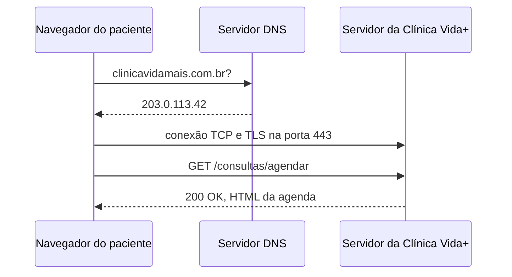

# Arquitetura da requisição — Clínica Vida+

## O caminho de uma requisição



**Observação:** o endereço `203.0.113.42` no diagrama é ilustrativo. Ele não representa o resultado de uma consulta real ao domínio da clínica.

## Evidência do DNS

Foi utilizado o comando `nslookup github.com` para consultar o endereço IP do domínio GitHub.

```text
C:\Users\reisd>nslookup github.com
Servidor:  ns3.uninove.br
Address:  186.251.39.123

Não é resposta autoritativa:
Nome:    github.com
Address:  4.228.31.150
```

O servidor DNS consultado foi `ns3.uninove.br`, com endereço `186.251.39.123`. A consulta retornou o endereço `4.228.31.150` para `github.com`. O teste de `ping` também apresentou esse IP.

## Evidência do HTTP

As requisições abaixo foram observadas na aba Network do DevTools durante a navegação no GitHub.

| Nº | Método | Recurso solicitado | Código de status |
|---|---|---|---|
| 1 | GET | `/assets/ha8.209c393db44e8a43.module.css` | 200 OK |
| 2 | GET | `/assets/td-038f13f065ff4131.js` | 200 OK |
| 3 | GET | `/static/images/modules/dashboard/promos/universe26-virtual-static.svg` | 200 OK |
| 4 | GET | `/_filter/repositories?limit=3&q=&filter_value=` | 304 Not Modified |

### Análise dos recursos

- **CSS:** arquivo de estilos que define a aparência da página. O tipo de conteúdo observado foi `text/css`.
- **JavaScript:** arquivo utilizado para funcionalidades e interações da página. O tipo de conteúdo foi `application/javascript`.
- **Imagem SVG:** imagem vetorial utilizada na interface. O tipo de conteúdo foi `image/svg+xml`.
- **Consulta de repositórios:** requisição que retornou `304 Not Modified`, indicando que o recurso não precisava ser transferido novamente porque a versão em cache continuava válida.

### Cabeçalhos HTTP

Na requisição de consulta de repositórios, foram observados os seguintes valores:

- **Host / :authority:** `github.com`
- **User-Agent:** `Mozilla/5.0 (Windows NT 10.0; Win64; x64) AppleWebKit/537.36 (KHTML, like Gecko) Chrome/155.0.0.0 Safari/537.36`
- **Content-Type:** `application/json`

O campo `:authority` identifica o servidor de destino nas requisições HTTP/2 ou HTTP/3 e desempenha uma função equivalente à do cabeçalho `Host`. O `User-Agent` apresenta informações sobre o navegador e o sistema operacional. O `Content-Type` identifica o tipo de conteúdo indicado na requisição ou resposta.

## Teste de endereço inexistente — HTTP 404

Foi acessado o endereço `https://github.com/pagina-que-nao-existe?utm_source=chatgpt.com`.

| Método | Recurso solicitado | Código de status |
|---|---|---|
| GET | `/pagina-que-nao-existe?utm_source=chatgpt.com` | 404 Not Found |

O servidor retornou `404 Not Found`, indicando que a página solicitada não foi encontrada.

## Por que o formulário da Clínica Vida+ precisa de HTTPS?

O formulário de agendamento da Clínica Vida+ precisa utilizar HTTPS para proteger os dados transmitidos entre o paciente e o servidor. Ele pode receber informações pessoais, como nome e telefone, além de dados sensíveis de saúde, como o motivo da consulta. O HTTPS utiliza criptografia para dificultar a interceptação ou alteração desses dados durante a transmissão. Assim, contribui para a privacidade dos pacientes e para a segurança do agendamento.